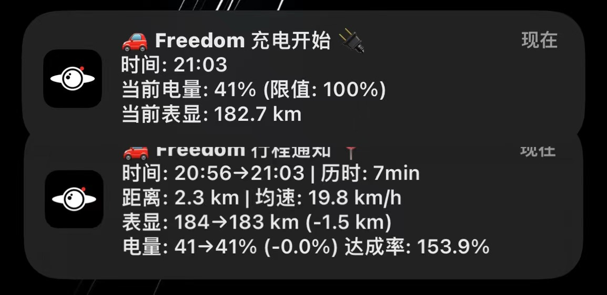
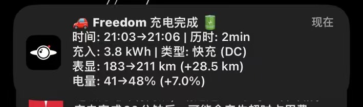

# tete-notifier

为 Teslamate 自建用户打造的轻量通知工具。通过 MQTT 监听车辆状态，结合数据库查询，在行程结束时自动推送美观格式的通知到「特特管家」iOS App。持续优化中...

## 通知样式

### 通知截图1


### 通知截图2


## 功能特性

- 行程、充电信息自动推送通知
- 车辆启动通知：挡位由 P 挡切换到 D 挡，且持续保持 D 挡一段时间（默认 10 秒）后推送，避免误触发
- 车门打开通知：主驾车门由关闭变为打开时推送，附带当前电量与表显续航
- 包含行驶时间、距离、电量变化等详细信息
- 集成到现有的 Teslamate docker-compose 环境中
- 轻量级，资源占用低
- 支持多平台（amd64、arm64）

## Docker 部署

### 前提条件

- 已运行 Teslamate（包含 database 和 mosquitto 服务）
- 基于 Teslamate v3.0.0 开发，其他版本车友已验证可用
- Docker 和 Docker Compose 已安装

### 安装步骤

1. **编辑你的 `docker-compose.yml` 文件**，在 `services` 部分添加以下内容（参考 `docker-compose.yml.example`）：

   ```yaml
   services:
     # ... 现有的 Teslamate 服务 ...
     
     tete-notifier-1:
       image: atmarss/tete-notifier:latest
       restart: always
       environment:
         - API_TOKEN= #特特管家完整的API地址
         - DATABASE_HOST=database #对应数据库服务名
         - DATABASE_USER=teslamate
         - DATABASE_PASS= #数据库密码
         - DATABASE_NAME=teslamate
         - MQTT_HOST=mosquitto #对应MQTT服务名
         - CAR_ID=1 #车辆id 默认1
         - PUSH_DEBOUNCE_SECONDS=5 #推送防抖动初始时间（秒） 默认5
         - ENABLE_START_NOTIFY=true #车辆启动通知开关，默认true
         - START_CONFIRM_SECONDS=10 #P->D后需持续D档的确认秒数，默认10
         - START_NOTIFY_COOLDOWN_SECONDS=60 #启动通知冷却时间（秒） 默认60
         - ENABLE_DOOR_NOTIFY=true #车门打开通知开关，默认true
         - DOOR_NOTIFY_COOLDOWN_SECONDS=60 #开门通知冷却时间（秒），默认60
       depends_on:
         - database #依赖数据库服务，同上HOST
         - mosquitto #依赖MQTT服务，同上HOST

     # 如有多辆车，请再新增容器，修改CAR_ID（车友已验证可行）
   ```

2. **配置说明**

   | 环境变量 | 说明 | 必填 | 默认值 |
   |---------|------|------|--------|
   | API_TOKEN | 特特管家的完整推送 API 地址 | 是 | - |
   | DATABASE_HOST | 数据库主机名 | 否 | database |
   | DATABASE_USER | 数据库用户名 | 否 | teslamate |
   | DATABASE_PASS | 数据库密码 | 是 | - |
   | DATABASE_NAME | 数据库名称 | 否 | teslamate |
   | MQTT_HOST | MQTT 主机名 | 否 | mosquitto |
   | CAR_ID | 车辆 ID | 否 | 1 |
   | PUSH_DEBOUNCE_SECONDS | 推送防抖动初始时间（秒） | 否 | 5 |
   | ENABLE_START_NOTIFY | 车辆启动时是否推送通知（P→D 且持续 D 档） | 否 | true |
   | START_CONFIRM_SECONDS | P→D 后需持续 D 档的确认秒数，避免误触发 | 否 | 10 |
   | START_NOTIFY_COOLDOWN_SECONDS | 启动通知冷却时间（秒），避免重复推送 | 否 | 60 |
   | ENABLE_DOOR_NOTIFY | 车门打开时是否推送通知 | 否 | true |
   | DOOR_NOTIFY_COOLDOWN_SECONDS | 开门通知冷却时间（秒），避免重复推送 | 否 | 60 |

3. **启动服务**

   如果你已经有正在运行的容器，使用以下命令（只会更新有变化的容器）：

   ```bash
   docker compose up -d
   ```

   Docker Compose 会自动检测变化，只重新创建新增的 `tete-notifier-1` 容器，不会影响其他正在运行的容器。

   如果需要更新镜像版本，请执行以下命令：

   ```bash
   docker compose pull tete-notifier-1
   docker compose up -d tete-notifier-1
   ```

4. **查看日志**

   ```bash
   docker compose logs -f tete-notifier-1
   ```

## 镜像说明

镜像 `atmarss/tete-notifier:latest` 由本仓库的 GitHub Actions（`.github/workflows/docker-build.yml`）自动构建并推送到 Docker Hub，同时支持 linux/amd64 与 linux/arm64。

- 推送到 `main` 分支 → 更新 `latest` 镜像
- 打 `v*` 标签（如 `v1.1.0`）→ 同时更新 `latest` 与对应版本标签

如需自行构建/改镜像地址，先在仓库 **Settings → Secrets and variables → Actions** 中添加一个 Secret：

| Secret 名 | 说明 |
|-----------|------|
| `DOCKERHUB_TOKEN` | Docker Hub 的 Access Token（在 Docker Hub → Account Settings → Security 中生成，需要读写权限）|

Docker Hub 用户名已固定为 `atmarss`，无需额外配置。若你改用自己的 Docker Hub 账号，请同步修改 workflow 里的 `username` 与 `IMAGE`，以及 `docker-compose.yml.example` 中的 `image`。

## 获取 API_TOKEN

1. 在「特特管家」iOS App 中获取完整的推送 API 地址
2. 将 API 填入 `API_TOKEN` 环境变量

## 版本说明

- `v1.0.0` - 初始版本，支持行程结束、充电结束、哨兵模式状态变更自动通知（该版本推送存在Bug，不可用）
- `v1.0.1` - 移除哨兵通知，新增充电开始通知，调整通知内容样式，优化推送逻辑
- `v1.0.2` - 调整了通知中电量变化的格式（+5.0% —> +5%）
- `v1.1.0` - 新增车辆启动通知（P→D 持续 D 档 10 秒后推送）、车门打开通知；修复并发数据竞争、防抖计时器未复位、推送无超时等 BUG

## 技术栈

- Go 语言
- GORM（数据库 ORM）
- paho.mqtt.golang（MQTT 客户端）

## 本地开发

```bash
# 克隆项目
git clone https://github.com/atmarss/tete-notifier.git

# 配置环境变量
cp .env.example .env
# 编辑 .env 文件

# 运行
go run ./cmd/app
```

## License

MIT License
